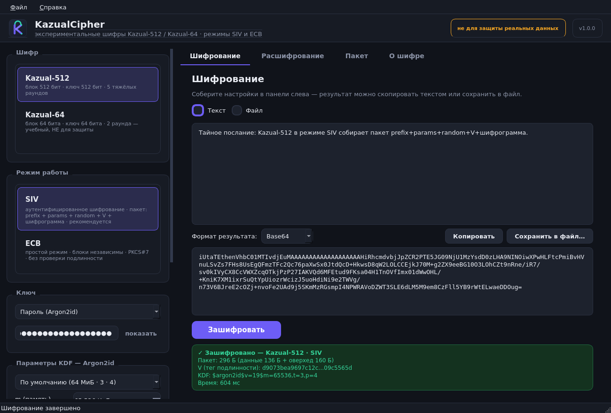
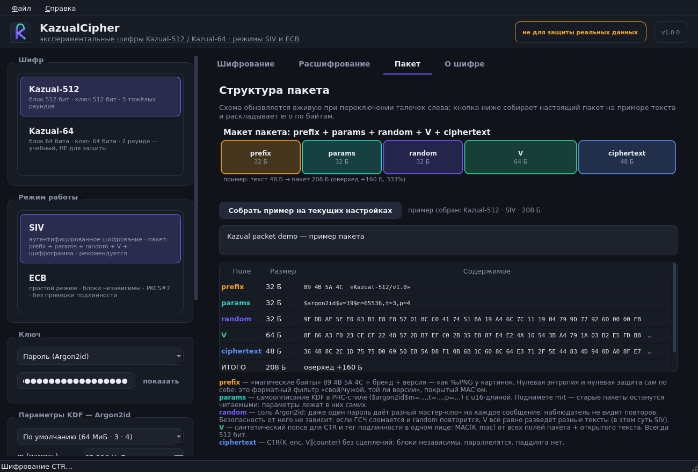

# KazualCipher

**Графическая оболочка и режимы работы для семейства экспериментальных
блочных шифров Kazual-512 / Kazual-64.**
Пароль → Argon2id → аутентифицированный SIV-пакет
(`prefix + params + random + V + шифрограмма`) или простой ECB — всё
настраивается галочками в GUI, без правки кода.

> ⚠️ **Честно о безопасности.** Kazual — экспериментальная учебная
> конструкция: она **не проходила независимого криптоанализа**, не имеет
> формального доказательства стойкости и **не предназначена для защиты
> реальных данных**. Kazual-64 — учебный шифр (блок и ключ 64 бита), не для
> защиты данных ни при каких условиях. Подробности — вкладка «О шифре» и
> [`docs/specification.html`](docs/specification.html).



---

## Возможности

- **Два шифра, выбор списком:** Kazual-512 (блок/ключ 512 бит, 5 тяжёлых
  раундов) и Kazual-64 (учебная копия: блок/ключ 64 бита, 2 раунда).
- **Два режима:**
  - **SIV** — аутентифицированное шифрование с синтетическим IV: тег `V`
    одновременно nonce для CTR и MAC от *всех* полей пакета и открытого
    текста; любая подмена любого байта обнаруживается;
  - **ECB** — простой режим: независимые блоки + PKCS#7, без аутентификации
    (учебно-демонстрационный, о чём GUI предупреждает).
- **Тонкая настройка пакета галочками** (всё живьём видно на вкладке
  «Пакет»):
  | поле | размер | регулировка |
  |---|---|---|
  | `prefix` | 256 бит | магические байты `89 4B 5A 4C` + свой текст бренда/версии; можно отключить |
  | `params` | u16 + ASCII | свои параметры Argon2id (m, t, p) в PHC-строке `$argon2id$v=19$m=65536,t=3,p=4`; можно отключить |
  | `random` | 256 бит | соль/nonce: генератор или фиксированное hex-значение; можно отключить (детерминизм) |
  | `V` | 512 бит | всегда в пакете: nonce CTR + тег подлинности |
  | `шифрограмма` | = тексту | `CTR(K_enc, V‖counter)`, без паддинга |
- **Источники ключа:** пароль через Argon2id (пресеты и ручные m/t/p,
  PHC-строка на экране) или сырой hex-ключ произвольной длины (растягивается
  собственной губкой ГОРН-1024).
- **Самоописание:** параметры KDF лежат в самом пакете — подняли `m/t`,
  а старые пакеты всё равно читаются.
- Текст ↔ Base64/HEX, файл ↔ файл, прогресс и отмена, проверка подлинности
  с понятными ошибками («неверный пароль / повреждено / настройки полей не
  совпадают»), живая схема пакета и разбор реального примера по байтам.
- Консоль для всего того же: `python -m kazual enc …` / `dec …`, плюс
  `selftest`, `vectors`, `trace`, `bench`.



## Быстрый старт

Нужен **Python 3.9+** (проверено на 3.10–3.12), Windows / Linux / macOS.

### Вариант 1: двойной клик (Windows)

Просто запустите **`start.bat`** двойным кликом. При первом запуске он сам
создаст `.venv`, сам поставит зависимости (нужен интернет) и откроет GUI;
при ошибке окно не закроется, а покажет причину. На Linux/macOS то же
делает `./start.sh`.

### Вариант 2: вручную

```bash
git clone <ваш-репозиторий> KazualCipher
cd KazualCipher

python -m venv .venv
# Linux/macOS:
source .venv/bin/activate
# Windows:
#   .venv\Scripts\activate

pip install -r requirements.txt
python main.py
```

Без виртуального окружения: `pip install -r requirements.txt && python main.py`.

> **Почему в архиве/репозитории нет `.venv`?** Виртуальное окружение
> привязано к конкретному компьютеру и ОС (абсолютные пути, чужие бинари) —
> перенести его невозможно, поэтому `.venv` создаётся у вас один раз
> командами выше или автоматически через `start.bat` / `start.sh` и не
> коммитится (см. `.gitignore`).
>
> **Кликнули `main.py` напрямую и окно закрылось?** Значит, системный
> Python не видит зависимости: окно теперь остаётся открытым и печатает
> инструкцию. Лечится запуском через `start.bat` или активированным `.venv`.

NumPy необязателен, но ускоряет пакетный путь в десятки раз; без него
работает скалярный путь (медленнее). PySide6 и argon2-cffi обязательны.

### Консоль

```bash
python -m kazual                      # то же, что python main.py (GUI)
python -m kazual vectors              # тестовые векторы (§14 спецификации)
python -m kazual selftest             # полные самопроверки (~15 с)
python -m kazual bench                # замер скорости

# зашифровать файл (пароль спрашивается из аргументов; см. --help)
python -m kazual enc --cipher Kazual-512 --password "секрет" \
    --input письмо.txt --output письмо.kaz
python -m kazual dec --cipher Kazual-512 --password "секрет" \
    --input письмо.kaz --output письмо.txt

# тонкая настройка из терминала — те же «галочки»:
python -m kazual enc --text "привет" --key-hex deadbeefcafebabe \
    --no-random --prefix-text "мой-бренд/v2" --kdf 65536,3,4
```

## Структура проекта

```
main.py                  точка входа GUI
start.bat / start.sh     запуск двойным кликом: создаёт .venv, ставит
                         зависимости, открывает GUI (Windows / Linux+mac)
kazual/
  cipher/                эталонная реализация шифров (§1–§12 спецификации)
    gf.py                  поля GF(2⁸)/GF(2¹⁶), Cauchy-MDS, табличные MDS
    gorn.py                ГОРН-1024: губка, дайджест, KDF-расширение,
                           инкрементальный хэшер, обратный ход (самопроверка)
    sbox.py                статические S-box'ы (Gold/Kasami/inverse)
    forge.py               КУЗНИЦА: равномерный разбор материала расширения
    components.py          Несущая (CarryWeave) и Заслонка (Shutter)
    spec.py                инстанции Kazual-512 / Kazual-64 / Kazual-Micro
    rounds.py              F (необратимый SPN) и H (ортоморфизм → Веер MDS)
    schedule.py            расписание ключей: ГОРН → GFN Type-2 → КУЗНИЦА
    core.py                каркас Лай–Мэсси: encrypt/decrypt блока
    batch.py               пакетный путь NumPy / CuPy / multiprocessing
    vectors.py             тестовые векторы
    selfcheck.py           самопроверки, трассы, бенчмарк
  modes/                 режимы: siv.py (пакет), ecb.py, ctr.py, mac.py,
                         padding.py
  kdf.py                 Argon2id + PHC-параметры (самоописание пакета)
  keys.py                пароль / сырой ключ → K_enc ‖ K_mac
  engine.py              фасад «настройки → данные → результат» (GUI + CLI)
  cli.py                 консольный интерфейс (python -m kazual …)
  app/                   GUI на PySide6: тема, сайдбар, страницы, воркеры
tests/                   pytest-набор (для разработки, не для пользователя)
docs/specification.html  полная спецификация Kazual-512/64
assets/                  иконка и скриншоты
```

## Тесты

Тесты — инструмент разработки, пользователю они не нужны.

```bash
pip install -r requirements-dev.txt
pytest                 # основной набор (~1 мин)
pytest -m slow         # полные самопроверки эталона (~20 с)
pytest -m gui          # смоук GUI в offscreen-режиме
```

Покрыто: побитовое совпадение с тестовыми векторами спецификации;
эквивалентность пакетного (NumPy) и скалярного путей; раундтрипы обоих
шифров в SIV при **всех** комбинациях галочек prefix/params/random;
обнаружение подмены каждого поля пакета; детерминизм без `random`;
самоописание `params`; границы Argon2 и разбор PHC-строк; PKCS#7;
инкрементальный ГОРН ≡ однопроходный; смоук GUI.

## Скорость (ориентиры)

Эталонная реализация — чистый Python (+ NumPy для независимых блоков):

| операция | порядок величин |
|---|---|
| расписание ключа Kazual-512 | ~0.5 с (кэшируется на операцию) |
| шифрование блока (скаляр) | ~4 мс |
| пакетный путь NumPy | в десятки раз быстрее скаляра |
| MAC/ГОРН | ~100 КиБ/с |

Для текста и небольших файлов этого достаточно; для сотен мегабайт
закладывайте минуты — GUI показывает прогресс и умеет отменять.

## Лицензия

MIT — см. [LICENSE](LICENSE) (включает примечание о криптостойкости).
